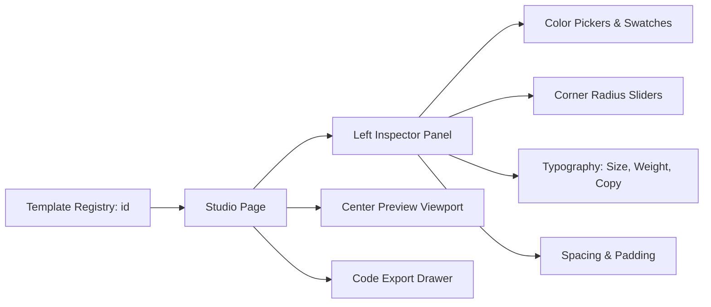

# [[architecture|Fetch]] — Studio Workspace Specification

The **Studio** (`app/studio/[id]/page.tsx`) is a dedicated full-screen customization environment for individual components.

## Layout Structure
- **Top Navigation Bar:**
  - Back to Catalog (`/components`)
  - Active Template Name & Category badge
  - Viewport Switcher (Desktop: 100%, Tablet: 768px, Mobile: 375px)
  - "Copy Code" primary button

- **Left Inspector Sidebar (`components/studio/inspector-panel.tsx`):**
  - **Colors Section:** Primary accent, Background, Surface, Border, Text.
  - **Geometry Section:** Corner radius slider (`0px` to `24px`) + preset buttons (Sharp, Subtle, Smooth, Pill).
  - **Typography Section:** Font size scale, font weight, live text label editing.
  - **Spacing & Padding:** Component internal padding sliders.

- **Center Stage Canvas (`components/studio/preview-viewport.tsx`):**
  - High-contrast isolated canvas with subtle dot grid or slate background.
  - Live component reacting in real-time to all inspector controls.
  - Scoped inside container with CSS variables.

- **Code Drawer / Modal (`components/studio/code-export-modal.tsx`):**
  - Syntax highlighted code with tabs:
    - **Tailwind JSX:** Self-contained inline Tailwind markup.
    - **Theme Tokens:** Semantic `var(--...)` custom properties snippet.
  - 1-click clipboard copy with visual confirmation.

---
Related: [[architecture]] | [[Component Catalog]] | [[Design Tokens]] | [[Landing Page Spec]]

