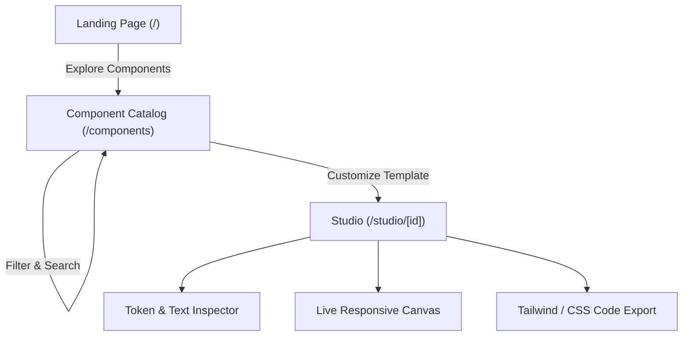

# Fetch — Multi-Page Architecture & System Specification

## 1. Intent & Architectural Vision
Fetch is a live-configurable UI component platform designed for modern web developers.

Instead of an all-in-one single-page application with inline widget clutter, Fetch is structured as an **elevated 3-tier product journey**:
1. **The Landing Page (`/`)**: An informational, editorial, and minimalist presentation of Fetch's engineering ethos and design philosophy (inspired by Vantra Studio, Idealworks, and Plumeform). Zero gradient text, crisp monochrome typography, architectural hairline grid layouts.
2. **The Component Catalog (`/components`)**: A dedicated directory featuring real-time search, category/design type filter tabs, and rich preview cards with a "Customize in Studio" CTA.
3. **The Customizer Studio (`/studio/[id]`)**: A dedicated full-page customization workspace where developers adjust colors, corner radiuses, typography (font size, weight, letter spacing, live text copy), spacing, and padding before copying production-ready code.



---

## 2. Core Knowledge Map
- **[[Tech Stack]]**: Next.js 15 (App Router), TypeScript, Tailwind CSS, Radix UI Primitives, Lucide React.
- **[[Design Tokens]]**: CSS custom properties, theme presets, and container scoping rules.
- **[[Landing Page Spec]]**: Editorial layout specification (Vantra / Idealworks / Plumeform aesthetic, hairline grids, zero gradient text).
- **[[Component Catalog]]**: Searchable and filterable directory on `/components`.
- **[[Studio Workspace Spec]]**: Dedicated full-screen live customizer on `/studio/[id]`.
- **[[Roadmap]]**: Multi-page redesign and implementation roadmap.

---

## 2. Design Aesthetic Guidelines
- **Monochrome & High Contrast:** Deep slate/black base (`#09090b`), off-white text (`#fafafa`), and muted zinc secondary copy (`#a1a1aa`).
- **No Gradient Text:** Headlines rely purely on bold, high-craft editorial typography (tracking, weight, contrast), eliminating "vibecoded" flashy AI neon gradients.
- **Architectural Grid Lines:** Subtle hairline dividers (`border-zinc-800/80` or `divide-zinc-800`) structuring content into balanced architectural blocks.
- **Micro-Interactions:** Snappy hover states (`active:scale-[0.98]`, subtle opacity changes) without excessive bouncy animations.

---

## 3. Route & Component Architecture

```
fetch/
├── app/
│   ├── layout.tsx                 # Root layout with font definitions and metadata
│   ├── page.tsx                   # Tier 1: Informational Editorial Landing Page
│   ├── components/
│   │   └── page.tsx               # Tier 2: Searchable & Filterable Template Catalog
│   ├── studio/
│   │   └── [id]/
│   │       └── page.tsx           # Tier 3: Dedicated Full-Screen Customizer Studio
│   └── globals.css                # Base Tailwind & CSS variable declarations
├── components/
│   ├── landing/                   # Landing Page Editorial Sections
│   │   ├── navbar.tsx             # Global navigation with active route highlights
│   │   ├── editorial-hero.tsx     # Typography-driven value prop without playground clutter
│   │   ├── engineering-ethos.tsx  # Architectural grid showcasing core design principles
│   │   ├── curated-showcase.tsx   # Static editorial preview of featured components
│   │   └── editorial-footer.tsx   # Minimalist footer
│   ├── catalog/                   # Catalog Gallery Components
│   │   ├── catalog-header.tsx     # Search input & category filter pills
│   │   └── template-card.tsx      # Preview thumbnail, description & studio launcher
│   ├── studio/                    # Studio Workspace Components
│   │   ├── studio-header.tsx      # Component breadcrumbs, viewport switcher, code drawer toggle
│   │   ├── inspector-panel.tsx    # Controls: Colors, Radius, Typography, Padding, Text Copy
│   │   ├── preview-viewport.tsx   # Isolated canvas rendering the active template
│   │   └── code-export-modal.tsx  # Dual tab export (Tailwind JSX vs Theme Tokens)
│   └── ui/                        # Reusable foundational primitives
│       ├── button.tsx
│       ├── badge.tsx
│       ├── card.tsx
│       ├── input.tsx
│       ├── slider.tsx
│       └── dialog.tsx
├── lib/
│   ├── templates.ts               # Typed Template Registry with default tokens & props
│   ├── tokens.ts                  # Design token utilities & code serializers
│   └── utils.ts                   # Class merging (`cn`) & clipboard helpers
```

---

## 4. Template Registry Schema (`lib/templates.ts`)
Each component template in Fetch is defined as a strongly-typed schema:

```typescript
export interface TemplateProperty {
  key: string;
  label: string;
  type: "text" | "color" | "radius" | "slider" | "select";
  defaultValue: any;
  options?: string[];
  min?: number;
  max?: number;
}

export interface ComponentTemplate {
  id: string;
  name: string;
  category: "primitives" | "patterns" | "forms" | "navigation";
  description: string;
  defaultTokens: ThemeTokens;
  configurableProps: TemplateProperty[];
  renderComponent: (props: any, tokens: ThemeTokens) => React.ReactNode;
  generateJsx: (props: any, tokens: ThemeTokens) => string;
}
```

### Initial MVP Templates:
1. **Primary Button** (Category: *Primitives*) — Customizable text, radius, padding, primary color, hover opacity.
2. **Elevated Card** (Category: *Primitives*) — Customizable title, body copy, badge text, surface elevation, radius.
3. **Form Input** (Category: *Primitives*) — Customizable label, placeholder, helper text, focus ring color, radius.
4. **Auth Card Pattern** (Category: *Patterns*) — Email/Password input with submit button, customizable headline and brand accent.
5. **Metric Stat Card** (Category: *Patterns*) — KPI number, percentage badge, title, customizable colors and radius.
6. **Newsletter Banner** (Category: *Patterns*) — Inline input + button compound component.

---

## 5. What is Left to the Builder
- Specific visual mockups and SVG accents for the architectural grid.
- Viewport width switcher implementation details in `/studio/[id]` (Responsive Desktop / Tablet / Mobile frames).
- Exact text copy and micro-interactions.
