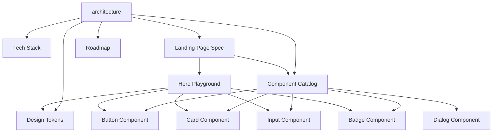

# Fetch — System Architecture & Map of Content

Welcome to the **Fetch Knowledge Base**. This document serves as the master Map of Content (MOC) connecting all architectural, technical, and component specifications.

---

## 1. Executive Summary & Vision
Static UI component libraries require developers to either accept opinionated styling defaults or spend significant time manually re-styling components with custom CSS.

**Fetch** provides a **live-configurable component platform**. Developers visually tweak design tokens (colors, border radiuses, spacing, elevation) on interactive components, see the changes reflected instantly in the browser, and copy production-ready code with their customizations already wired in.

---

## 2. Core Knowledge Map

- **[[Tech Stack]]**: Next.js 15 (App Router), TypeScript, Tailwind CSS, Radix UI Primitives, Lucide React, and Zustand.
- **[[Design Tokens]]**: CSS Custom Properties (`--primary`, `--radius`, `--surface`), theme presets, and container scoping rules.
- **[[Landing Page Spec]]**: Complete layout specification for the Phase 1 landing page (Hero, Value Pillars, Showcase Grid, Quickstart, Footer).
- **[[Hero Playground]]**: The interactive teaser card embedded in the hero section for instant live token tweaking.
- **[[Component Catalog]]**: The five foundational MVP primitives:
  - [[Button Component]]
  - [[Card Component]]
  - [[Input Component]]
  - [[Badge Component]]
  - [[Dialog Component]]
- **[[Roadmap]]**: Phased execution roadmap tracking Phase 1 (Landing Page) and Phase 2 (Full Studio).

---

## 3. Approaches Considered & Selection

| Approach | Architecture | Trade-offs | Verdict |
| :--- | :--- | :--- | :--- |
| **Approach 1: Integrated Next.js App Router** | Single repository with Next.js 15, App Router, `/components/ui` for library primitives, and `/components/landing` for marketing. | Fast setup, shared component imports for the hero teaser, zero monorepo configuration overhead. | **Selected (Approved)** |
| **Approach 2: Turborepo Monorepo** | Multi-package repo (`apps/web`, `packages/ui`). | Strict packaging from day one, but high initial boilerplate and build pipeline complexity. | Rejected for MVP velocity |
| **Approach 3: Client-Only Vite SPA** | Standalone Vite + React client app. | Instant HMR, but lacks SSR, SEO, metadata tags, and social cards needed for a developer tool landing page. | Rejected |

---

## 4. Key Architectural Clarifications (Builder Review)
1. **Code Export Contract**: The [[Hero Playground]] will feature a clean tabbed view offering both **Tailwind JSX** (self-contained inline utility classes) and **Theme Tokens** (`rounded-[var(--radius)]` + CSS variable snippet).
2. **"Launch Studio" Navigation**: In Phase 1, the navbar button smooth-scrolls to the [[Hero Playground]] with a subtle *"Studio Full Canvas: Coming in Phase 2"* badge.
3. **Token Scoping**: CSS variables are scoped to preview containers (`.fetch-preview`), ensuring tweaking does not distort the marketing page layout. Radix Dialog portals are container-bound.
4. **Developer Quickstart**: Phase 1 provides copyable manual setup instructions and component source snippets (no custom CLI or backend microservice needed for the MVP).
